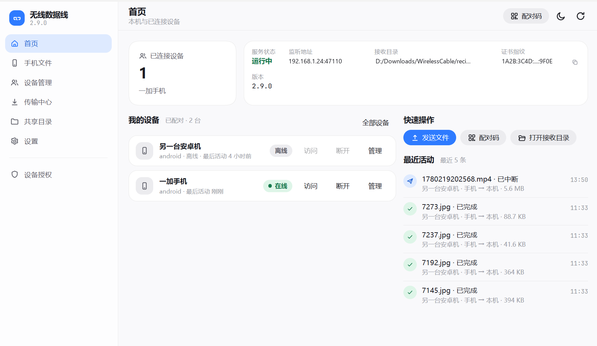
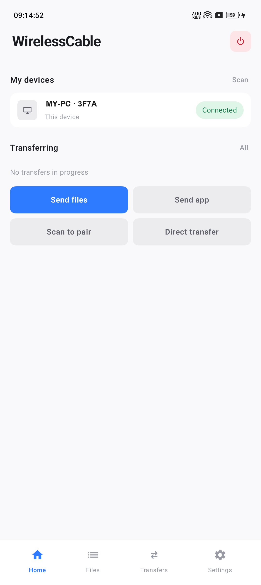

[**中文**](README.md) | English

> **This repository contains a large amount of AI-generated content**, including but not limited to code,
> `README.md` and `CONTRIBUTING.md`. Individual files do not repeat this notice.

# WirelessCable

**A wireless data cable.** Move files between your phone and PC over your own LAN —
no cloud, no cable, no account.

<sub>Android + Windows · LAN only · self-signed certs with pinned fingerprints · no accounts, no telemetry</sub>

<sub>中文：[README.md](README.md) ｜ [使用指南](docs/使用指南.md) — Phone: Settings → Appearance → Language (System / 中文 / English). PC: one-click toggle at the bottom of the sidebar. Both apply instantly.</sub>



<sub>Device names, IPs and certificate fingerprints in the screenshot are placeholders.</sub>

---

## What it does

- **Phone ↔ PC file transfer**: either direction, whole folders included, resumes after a drop.
- **Browse your phone on the PC**: PC reads folders the phone has shared (four permission tiers: none / read-only / read-write without delete / full).
- **Browse your PC on the phone**: share a folder from the PC, download it on the phone.
- **Share sheet integration**: from Gallery, Files or a browser, tap Share → WirelessCable → pick a PC or "direct transfer".
- **Phone-to-phone**: two phones transfer by scanning a QR code, no PC involved.
- **Hotspot fallback**: if the phone is not on Wi-Fi, tick **Use a hotspot** when generating the
  QR code and the PC opens one for you (off by default — starting a hotspot can knock a Wi-Fi-connected
  PC offline).

What it does **not** do: no internet relay, no account, no browser extension, and the phone never listens on a port.

---

## On the phone



Four tabs: **Home** (paired PCs, connection state, send files / scan to pair / direct transfer),
**Files** (folders shared from the PC plus the phone's inbox), **Transfers** (progress and history; pause, resume and cancel stay in sync across both ends,
and a cancel drops the record on both sides), **Settings** (background sync, grants, appearance
and language).

The desktop sidebar has **Get the phone app**: the phone downloads and installs the APK straight
from its browser, no cable needed.

**Release packages**: `WirelessCable-Release/` always holds exactly three files, all carrying the
version number — `WirelessCable-<version>.exe` (desktop), `WirelessCable-<version>.apk` (phone) and
`WirelessCable-<version>-portable.zip` (portable build, unzip and run). You can never pick up the
wrong build by accident.

The link is **bidirectional**: the PC can also browse folders the phone has shared, with four permission
tiers set per folder.

---

## Quick start

**PC**: unzip, run `WirelessCable.exe`. On first launch it asks to open the local port — click "Continue",
then approve the Windows elevation prompt. It installs its own firewall rules.

**Phone**: install the APK and grant two permissions — **All files access** (required to receive files)
and **Notifications** (optional; without it the service still runs, you just don't see the status notification).

**System requirements**: Windows 10 2004 (build 19041) or later, x64; Android 11 or later.

**Pairing**: PC "Home" shows a QR code → phone "Scan to pair". After that it reconnects automatically.

Full walkthrough: [`docs/en/guide.md`](docs/en/guide.md).

---

## Architecture

```
┌────────────────────┐        mDNS discovery + HTTPS (TLS, pinned fingerprint)   ┌──────────────────────┐
│  Android           │ ────────────────────────────────────────────────────────▶ │  Windows             │
│  Kotlin / Compose  │ ◀──────────────────────────────────────────────────────── │  .NET 9 + Kestrel    │
└────────────────────┘        chunked transfer · resume · whole-file SHA-256    └──────────────────────┘
          │                                                                    │  WPF legacy shell
          │ scan (one-shot HTTPS, self-signed)                                 └  WebView2 + React
          ▼
┌────────────────────┐
│  another Android   │
└────────────────────┘
```

- The PC is the **server** (listens on 47110, probes upward if taken); the phone is a **client**.
- Discovery uses mDNS (`_wirelesscable._tcp`); QR pairing does not need multicast.
- Certificates are self-signed and **pinned** on both ends; tokens are stored with AndroidKeyStore / DPAPI.

---

## Building from source

### Requirements

| Need | Version | Notes |
| --- | --- | --- |
| .NET SDK | 9.0 | Desktop. Scripts look for `~/.dotnet/dotnet.exe`; override with `DOTNET_BIN` |
| JDK | 17 | Android; scripts read `toolchain/jdk17` |
| Gradle | 8.7 | Scripts read `toolchain/gradle` |
| Android SDK | platform 35 / build-tools 34.0.0 | Scripts read `toolchain/android-sdk`; also create `android/local.properties` with `sdk.dir=<your SDK path>` (not committed) |
| Node.js | 20.19+ or 22.12+ | Only for building the embedded web UI (Vite 8 engine requirement); scripts run `vite build` |

`toolchain/` and `~/.dotnet` are **not** in the repository (see `.gitignore`). If your layout differs,
edit `JAVA_HOME` / `GRADLE` / `DOTNET_BIN` at the top of the scripts.

### Commands

```bash
# Desktop: single-file exe + portable folder (builds the web UI first)
bash scripts/build-desktop.sh

# Android: debug APK (for local testing)
bash scripts/build-android.sh

# Android: signed release APK (needs keys/ and keystore.properties)
bash scripts/build-android.sh --release

# All tests (xUnit + Android JVM unit tests)
bash scripts/test-all.sh

# Assemble the release folder (exe + apk + SHA256SUMS)
bash scripts/package-release.sh --minimal
```

**Signing**: `keys/*.jks` and `keystore.properties` are not in the repository; generate your own.
`assembleRelease` fails without them instead of producing an unsigned package.

**Version numbers** must be changed in two places: `<Version>` in `Directory.Build.props`, and
`versionName` / `versionCode` in `android/app/build.gradle.kts`.

---

## Repository layout

```
src/
  WirelessCable.Server           in-process Kestrel: endpoints, middleware, static hosting
  WirelessCable.Core             domain abstractions (files, transfer, diagnostics)
  WirelessCable.Protocol         wire contract shared by both ends
  WirelessCable.Storage          SQLite: entities, repositories, hand-written migrations
  WirelessCable.Infrastructure   certificates, mDNS, file providers, path guard
  WirelessCable.Desktop          WPF host + WebView2 + embedded React UI
android/app/src/main/kotlin      Kotlin / Compose single-module app
tests/                           xUnit (Core / Protocol / Server)
docs/                            user manuals (Chinese guide + troubleshooting manual)
scripts/                         build, test, package
```

---

## Docs

| Doc | Contents |
| --- | --- |
| [`docs/en/guide.md`](docs/en/guide.md) | End-user guide (English): install, pair, transfer, FAQ |
| [`docs/使用指南.md`](docs/使用指南.md) | Same guide in Chinese |
| [`docs/用户手册.md`](docs/用户手册.md) | Chinese manual with implementation details (troubleshooting) |
| [`ARCHITECTURE.en.md`](ARCHITECTURE.en.md) | Layers and key decisions ([中文](ARCHITECTURE.md)) |
| [`ARCHITECTURE.en.md`](ARCHITECTURE.en.md) | Layers and key decisions (中文: [ARCHITECTURE.md](ARCHITECTURE.md)) |

---

## Privacy

- Data stays **on your own LAN**; nothing is relayed through a cloud.
- Certificates are self-signed and pinned on both ends; "ignore certificate errors" is not an option.
- Device tokens are encrypted with AndroidKeyStore on the phone and DPAPI on the PC.
- No telemetry, no crash reporting, no accounts.

---

## Known limitations

- Windows and Android only.
- Same LAN required: guest networks and AP isolation block it (mDNS multicast does not cross them).
- The phone does not listen on any port, so the PC cannot initiate a connection to it.
- The server allows at most **3 concurrent tasks per device**; manual sends from the phone are queued one by one.
- The UI is bilingual (中文 / English) on both the phone and the desktop web UI. The native tray menu and
  startup dialogs follow the system language; the legacy WPF fallback window is Chinese only.

---

## Contributing

See [`CONTRIBUTING.md`](CONTRIBUTING.md) (Chinese) before opening a PR.

## License

[Apache-2.0](LICENSE). Third-party components: [`THIRD-PARTY-NOTICES.md`](THIRD-PARTY-NOTICES.md).
