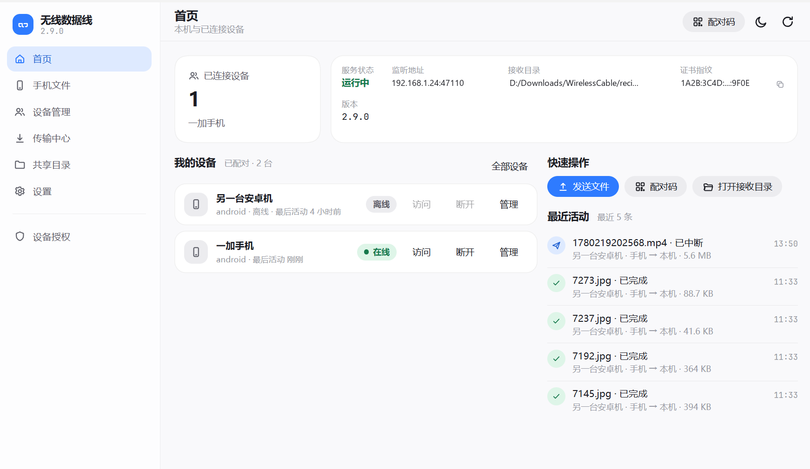
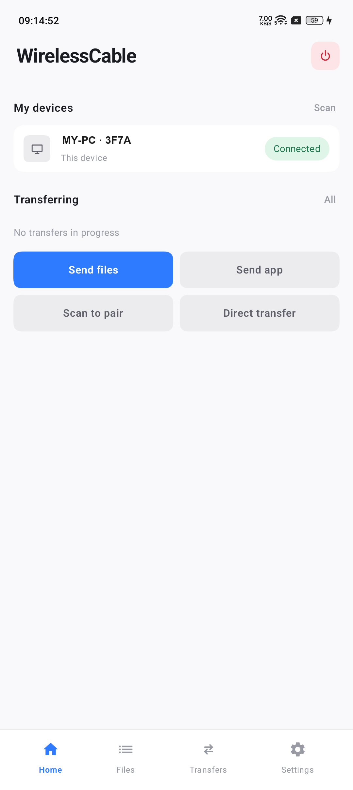

**中文** | [English](README.en.md)

> **本仓库包含大量 AI 生成内容**，包括但不限于代码、`README.md`、`CONTRIBUTING.md` 等；
> 文件内不再另附说明，请知悉。

# WirelessCable

**一根无线数据线。** 手机和电脑在同一个局域网里互传文件、浏览对方目录，不走云、不插线。

<sub>Android + Windows · 局域网直连 · 自签证书 + 指纹固定 · 无账号、无遥测</sub>

<sub>English: [README.en.md](README.en.md) ｜ [User guide](docs/en/guide.md) — 手机在「设置 → 外观 → 语言」选（跟随系统 / 中文 / English），电脑在侧栏底部一键切换，都即时生效。</sub>



<sub>截图里的设备名、IP 与证书指纹都是示例值。</sub>

---

## 它能做什么

- **手机 ↔ 电脑传文件**：手机发给电脑、电脑发给手机，整文件夹也行，断了能续。
- **在电脑上看手机**：电脑浏览手机授权的目录（四档权限：无权限 / 只读 / 读写不含删 / 读写+删除）。
- **在手机上看电脑**：电脑把某个文件夹授权给手机，手机直接下载。
- **系统分享直达**：相册、文件管理器、浏览器里点「分享」→ WirelessCable → 选电脑或「当面直连」。
- **两机直连**：两台手机之间扫码直传，不经过电脑。
- **电脑热点兜底**：手机没连 Wi-Fi 时，电脑开热点，手机连上继续用。

它**不**做的事：不上公网、不需要账号、不装浏览器插件、手机不监听任何端口。

---

## 手机端



底部四个标签：**首页**（已配对电脑、连接状态、发送文件 / 扫码配对 / 当面直连）、**文件**（电脑共享出来的目录 + 手机收件箱）、**传输**（进度与历史，可暂停、取消）、**设置**（后台同步、授权管理、外观与语言）。

手机与电脑是**双向**的：电脑也能反过来浏览手机里授权过的目录，四档权限逐目录设置。

---

## 快速开始

**电脑**：解压便携包，双击 `WirelessCable.exe`。首次启动会弹「放行本机端口」→ 点「继续」，Windows 再要一次管理员权限（UAC），同意后它自己加防火墙规则。

**手机**：安装 APK，给两个权限——**通知**（不给也能后台运行，只是看不到状态通知）、**所有文件访问权**（不给的话收不到文件）。

**系统要求**：Windows 10 2004（build 19041）及以上，x64；Android 11 及以上。

**配对**：电脑「首页」出二维码 → 手机「扫码配对」。之后自动连。

更完整的操作说明见 [`docs/使用指南.md`](docs/使用指南.md)。

---

## 架构

```
┌────────────────────┐        mDNS 发现 + HTTPS（TLS，证书指纹固定）        ┌──────────────────────┐
│  Android           │ ─────────────────────────────────────────────────▶ │  Windows             │
│  Kotlin / Compose  │ ◀───────────────────────────────────────────────── │  .NET 9 + Kestrel    │
└────────────────────┘        分块传输 · 断点续传 · 整文件 SHA-256          └──────────────────────┘
          │                                                                    │  WPF 旧界面
          │ 扫码（一次性 HTTPS，自签证书）                                       └  WebView2 + React
          ▼
┌────────────────────┐
│  另一台 Android     │
└────────────────────┘
```

- 电脑是**服务端**（监听 47110 起，占用则 +1 探测），手机是**客户端**。
- 发现走 mDNS（`_wirelesscable._tcp`）；扫码配对不依赖组播。
- 证书自签，两端都做**指纹固定**；令牌用 AndroidKeyStore / DPAPI 加密保存。

---

## 从源码构建

### 环境

| 需要 | 版本 | 说明 |
| --- | --- | --- |
| .NET SDK | 9.0 | 桌面端。脚本默认找 `~/.dotnet/dotnet.exe`，可用 `DOTNET_BIN` 覆盖 |
| JDK | 17 | 安卓端，脚本读 `toolchain/jdk17` |
| Gradle | 8.7 | 脚本读 `toolchain/gradle` |
| Android SDK | platform 35 / build-tools 34.0.0 | 脚本读 `toolchain/android-sdk`；另需新建 `android/local.properties` 写 `sdk.dir=<你的 SDK 路径>`（该文件不进仓库） |
| Node.js | 20.19+ 或 22.12+ | 只用于构建内嵌 Web 界面（Vite 8 的引擎要求），脚本会自动跑 `vite build` |

`toolchain/` 与 `~/.dotnet` **不进仓库**（见 `.gitignore`）。目录布局不一致时改脚本开头的
`JAVA_HOME` / `GRADLE` / `DOTNET_BIN` 即可。

### 命令

```bash
# 桌面端：单文件 exe + 便携目录（会先构建前端）
bash scripts/build-desktop.sh

# 安卓端：debug 包（装机自测）
bash scripts/build-android.sh

# 安卓端：签名 release 包（需要 keys/ 与 keystore.properties）
bash scripts/build-android.sh --release

# 全部测试（xUnit + Android JVM 单测）
bash scripts/test-all.sh

# 组装交付目录（exe + apk + SHA256SUMS）
bash scripts/package-release.sh --minimal
```

**签名**：`keys/*.jks` 与 `keystore.properties` 不在仓库里，自己生成一份填进去即可；
`assembleRelease` 缺这两个文件会直接失败，不会产出未签名包。

**版本号**要同时改两处：`Directory.Build.props` 的 `<Version>` 与
`android/app/build.gradle.kts` 的 `versionName` / `versionCode`。

---

## 目录结构

```
src/
  WirelessCable.Server          进程内 Kestrel：端点、中间件、静态托管
  WirelessCable.Core            领域抽象（文件、传输、诊断）
  WirelessCable.Protocol        协议契约（两端唯一事实源）
  WirelessCable.Storage         SQLite：实体、仓储、手写迁移
  WirelessCable.Infrastructure  证书、mDNS、文件提供器、路径守卫
  WirelessCable.Desktop         WPF 宿主 + WebView2 + 内嵌 React 界面
android/app/src/main/kotlin     Kotlin / Compose 单模块应用
tests/                          xUnit（Core / Protocol / Server）
docs/                           用户手册（使用指南 + 排障手册）
scripts/                        构建、测试、打包
```

---

## 文档

| 文档 | 内容 |
| --- | --- |
| [`docs/使用指南.md`](docs/使用指南.md) | 终端用户手册：装、连、传、常见问题 |
| [`docs/用户手册.md`](docs/用户手册.md) | 含实现细节的手册（排障用） |
| [`docs/en/guide.md`](docs/en/guide.md) | 同一份使用指南的英文版 |
| [`ARCHITECTURE.md`](ARCHITECTURE.md) | 分层与关键决策 |

---

## 隐私

- 数据**只在你自己的局域网里**，没有任何云端中转。
- 证书自签，两端固定指纹，拒绝「忽略证书错误」。
- 手机保存的设备令牌用 AndroidKeyStore 加密；桌面端用 DPAPI。
- 没有遥测、没有崩溃上报、没有账号体系。

---

## 已知限制

- 只有 Windows + Android 两端。
- 必须同一个局域网：访客网络、AP 隔离会挡住（mDNS 组播过不去）。
- 手机不监听端口，电脑不能主动连手机。
- 服务端限制单设备最多 **3 个任务并发**；手机上手动发送是按顺序一个个来的。

---

## 参与贡献

见 [`CONTRIBUTING.md`](CONTRIBUTING.md)——提 PR 前先看一眼。

## 许可证

[Apache-2.0](LICENSE)。第三方依赖与声明见 [`THIRD-PARTY-NOTICES.md`](THIRD-PARTY-NOTICES.md)。

> 本项目与 Oink 项目无隶属关系；Web 界面使用了其 MIT 许可的 [`oink-ui`](https://github.com/oinkvm/oink-ui) 组件库。
